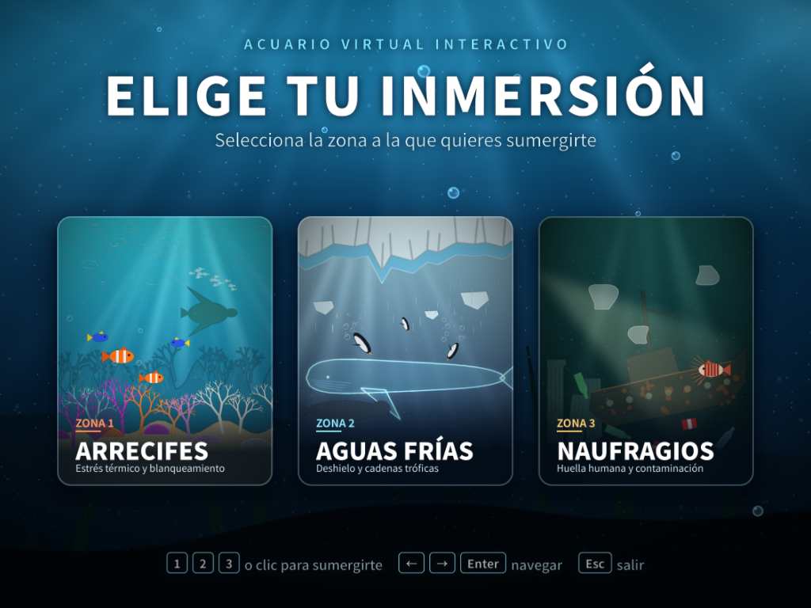
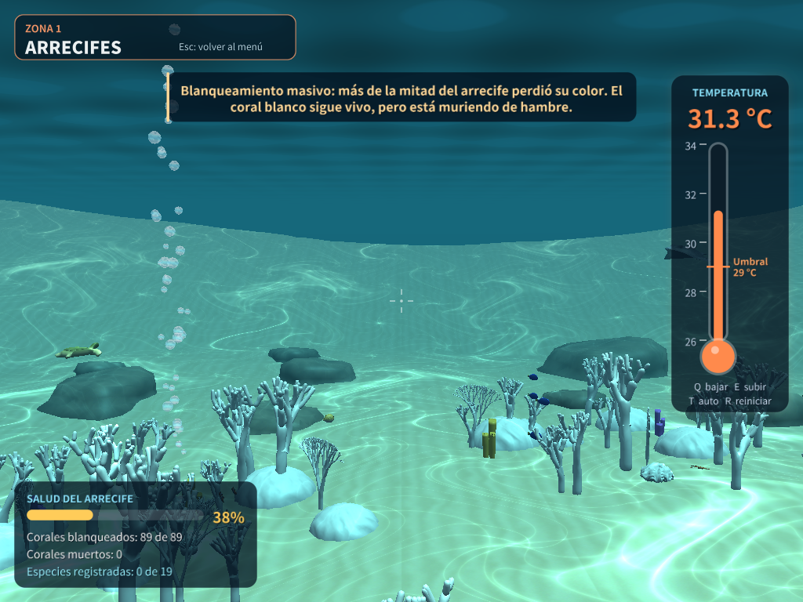
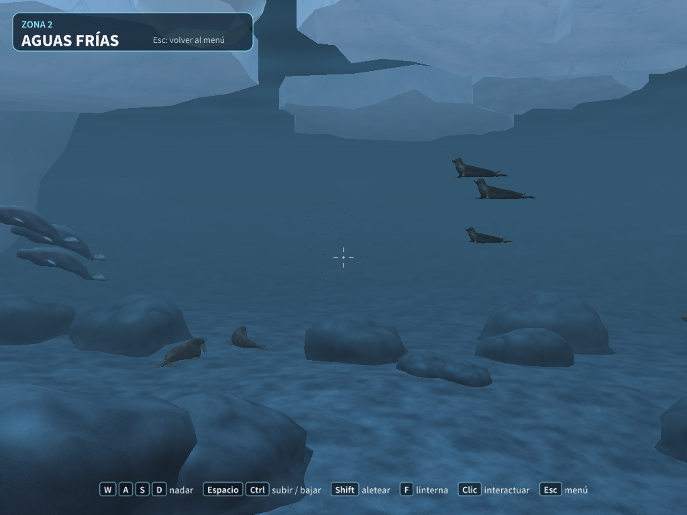
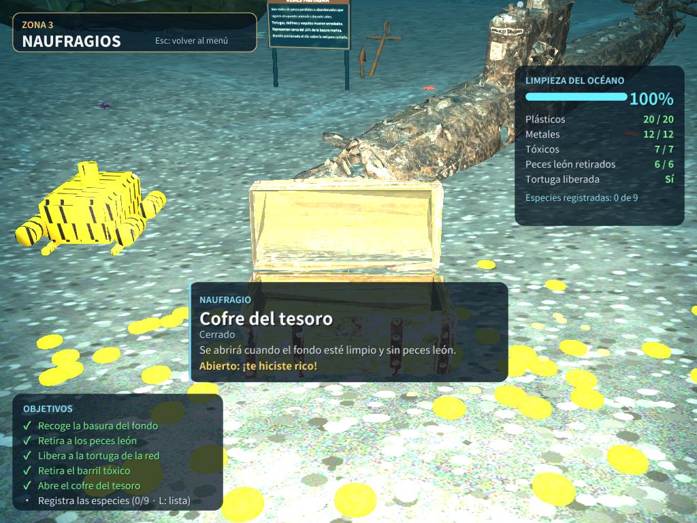

# 🌊 Acuario Virtual Interactivo

**Proyecto final de Computación Gráfica e Interacción Humano-Computadora** · Facultad de Ingeniería, UNAM · Grupo 2 · Dr. Sergio Teodoro Vite

Un recorrido submarino en primera persona, hecho en **C++ y OpenGL 3.3**, donde el usuario se convierte en buzo y explora tres zonas del océano. En cada una **provoca y revierte** un problema ambiental real para ver su causa y su efecto: el calentamiento que blanquea los corales, el deshielo que deja sin hábitat a la fauna polar y la basura que contamina el fondo marino.



---

## 🧭 El recorrido

Desde el menú se elige una zona (Enter empieza en la Zona 1). Al entrar, una tarjeta explica la historia, los objetivos y los controles. Al completar los objetivos aparece **"Siguiente zona"** y el buzo pasa solo a la siguiente: **Arrecifes → Aguas Frías → Naufragios → ¡Recorrido completado!**

La pantalla se mantiene limpia: solo se ve el objetivo actual, el indicador de la zona (termómetro o limpieza) y un aviso a la vez. Con **H** se muestran todos los paneles y con **I** la ficha completa del animal que señala la mira.

## 🐠 Las tres zonas

### Zona 1 · Arrecifes: estrés térmico y blanqueamiento
Un arrecife somero lleno de vida: 105 corales, anémonas con peces payaso, pradera de pasto marino, manatí, tortugas, delfines, pez loro, pulpo y pez globo.
- Con las flechas **↑ ↓** subes o bajas la temperatura del agua. A partir de **29 °C** los corales se **blanquean por manchas**; si el calor persiste, **mueren y los cubren las algas**. Si enfrías a tiempo, se recuperan.
- Los cardúmenes se reducen y el agua se enturbia conforme el arrecife se deteriora.
- Bitácora de 20 especies, fichas educativas y modo de inspección de modelos.



### Zona 2 · Aguas Frías: deshielo y cadenas tróficas
Plataformas de hielo, icebergs, una cueva de hielo y un rompehielos, con focas, pingüinos, morsas, oso polar, belugas, orcas, narvales, cachalote y ballena.
- Al calentar el agua (**T**) el hielo se derrite; los animales que dependen de él se convierten en **fantasmas** traslúcidos. Con **G** enfrías el agua para recuperarlo.
- Panel de la **cadena trófica** (krill → bacalao → focas y pingüinos → ballena y oso polar), fotografías de especies (**X**) y alimentación de los animales.



### Zona 3 · Naufragios: huella humana y contaminación
Un fondo oscuro y turbio con un submarino hundido, un barco en ruinas, ruinas clásicas, 39 residuos, un barril tóxico, peces león invasores y una tortuga atrapada en una red fantasma.
- **Cada residuo que recoges aclara el agua**: entra más luz, aparecen las cáusticas y regresan los peces nativos.
- Retira a los peces león (especie invasora), corta la red manteniendo el clic para **liberar a la tortuga** y un dron guía te señala la basura más cercana.
- Al terminar la misión, el **cofre del tesoro** se abre al acercarte y lanza una lluvia de monedas: *el verdadero tesoro es un océano limpio*.



---

## 🛠️ Tecnologías

| Categoría | Tecnología |
|---|---|
| Lenguaje | **C++17** |
| Gráficos | **OpenGL 3.3 (Core)** · **GLSL 330** |
| Ventana y entrada | **GLFW** · **GLAD** |
| Matemáticas | **GLM** |
| Modelos y texturas | **Assimp** (FBX/GLB) · **stb_image** |
| Audio | **irrKlang** |
| Modelado 3D | **Blender** · **Meshy AI** (modelos generados con IA y optimizados después) |
| Herramientas | **Python** (scripts de Blender `bpy`, Pillow, NumPy) para exportar y optimizar modelos |
| Desarrollo | **Visual Studio 2022** · **Git / GitHub** |

### Técnicas de computación gráfica implementadas
- **Iluminación Phong (Blinn)** con sol direccional, luz ambiental de hemisferio y **linterna** (reflector).
- **Cuatro materiales:** opaco, plástico, traslúcido y metálico.
- **Fresnel-Schlick** y **ley de Snell** en la superficie del agua vista desde abajo (ventana de Snell y reflexión total interna).
- **Óptica submarina:** absorción de la luz por canal según la profundidad, niebla exponencial y cáusticas.
- **Animación** simple (órbitas, cardúmenes, recorridos), **por cuadros clave** (cofre, columna, submarino, tortuga, pez loro), incluida la de **esqueleto (skinning)**, y **procedural** (ondulación al nadar, partículas, física de monedas, deshielo, blanqueamiento con ruido 3D).
- **Picking** por color con la mira central y asistencia de puntería.
- **Optimizaciones:** descarte por campo de visión y niebla, caché de *uniforms* y reducción de mallas.

---

## ▶️ Cómo compilar y ejecutar

**Requisitos:** Windows 10/11 de 64 bits, **Visual Studio 2022** con la carga de trabajo *Desarrollo para el escritorio con C++* y una tarjeta gráfica compatible con OpenGL 3.3.

1. Clona el repositorio:
   ```bash
   git clone https://github.com/davidjulian7/ProyectoGrafica.git
   ```
2. Abre `src/ProyectoFinal/Proyecto/ProyectoFinal/ProyectoFinal.sln`.
3. Elige **Release** y **x64** en la barra superior.
4. **Ctrl + Shift + B** para compilar y **F5** para ejecutar.

El ejecutable se genera en `src/bin/ProyectoFinal.exe`, junto a los recursos, y también se puede abrir con doble clic. Las bibliotecas ya vienen en `src/deps` y las DLL en `src/bin`, así que no hay que instalar nada más.

> Para compilar fuera del repositorio solo se necesitan las carpetas `src/ProyectoFinal`, `src/deps` y `src/bin`, juntas dentro de una carpeta `src`.

---

## 🎮 Controles

| Tecla / acción | Función |
|---|---|
| **1 / 2 / 3** o clic en la tarjeta | Elegir zona en el menú |
| **W A S D** | Nadar |
| **Espacio / Ctrl** | Subir / bajar |
| **Shift** | Aletear con más fuerza |
| **Ratón** | Mirar alrededor |
| **Clic** | Interactuar con lo que señala la mira (inspeccionar, recoger, retirar) |
| **Clic sostenido** | Cortar la red fantasma (Zona 3) |
| **L** | Lista de especies de la bitácora |
| **F** | Linterna |
| **V** | Cámara de órbita |
| **E** | Modo edición de objetos |
| **↑ / ↓ · T · R** | Temperatura · calentamiento automático · restaurar (Zona 1) |
| **T / G · X** | Calentar / enfriar · fotografiar (Zona 2) |
| **Enter / clic** | Empezar la zona (tarjeta de indicaciones) · pasar a la siguiente zona |
| **H** | Mostrar u ocultar todos los paneles (ayuda) |
| **I** | Ficha completa del animal u objeto bajo la mira |
| **F1** | Silenciar |
| **Esc** | Volver al menú / salir |

---

## 📁 Estructura del código

El código está organizado **por tema**, con los mismos temas de las prácticas del curso, y **cada zona es independiente**: lo que se cambia en una zona no afecta a las demás.

```
src/
├── ProyectoFinal/
│   ├── ProyectoFinal.cpp            ventana, bucle principal, menú ↔ zonas, teclado y ratón
│   └── include/
│       ├── base_opengl/   (prácticas 00, 01, 05)  shaders, carga de modelos y mallas
│       ├── camara/        (práctica 02)           cámara del buzo
│       ├── iluminacion/   (prácticas 07, 08, 14)  luces, linterna, niebla y materiales
│       ├── texturas/      (práctica 06)           cubemap
│       ├── animacion/     (prácticas 09–11)       cuadros clave, movimientos y partículas
│       ├── interaccion/   (práctica 13)           picking y modo edición
│       ├── interfaz/                              menú, HUD y fichas educativas
│       ├── escena/                                clase Escenario: objetos, render y carga
│       └── zonas/
│           ├── arrecifes/     arrecifes_escena.h · arrecifes_mecanica.h
│           ├── aguas_frias/   aguas_frias_escena.h · aguas_frias_mecanica.h
│           └── naufragios/    naufragios_escena.h · naufragios_mecanica.h
├── bin/
│   ├── shaders/zona1_arrecifes/ · zona2_aguas_frias/ · zona3_naufragios/   shaders propios de cada zona
│   ├── models/zonas/<zona>/   modelos FBX/GLB y sus texturas
│   ├── textures/  sound/      interfaz, cubemap y audio
│   └── *.dll                  Assimp e irrKlang
└── deps/                      GLFW, GLAD, GLM, Assimp e irrKlang
```

📖 La guía **[`LEEME_ESTRUCTURA.md`](src/ProyectoFinal/include/LEEME_ESTRUCTURA.md)** explica qué archivo cambiar para cada modificación típica: iluminación, texturas, animaciones, interfaz, etc. En el código, busca **`[CAMBIAR]`** y **`[AGREGAR]`** (Ctrl + Shift + F en Visual Studio).

Otras carpetas: `ModelosProyecto/` (archivos `.blend` originales), `herramientas/` (scripts que exportan y optimizan los modelos), `docs/evidencias/` (capturas) y `src/00_…` a `src/14_…` (prácticas del curso).

---

## 👥 Equipo

| Integrante | Rol principal |
|---|---|
| **Coronado Pérez Diego** | Líder del proyecto: integración del código, menú, Zonas 1 y 3, optimización y documentación |
| **Muñoz Norberto David Julián** | Repositorio y proyecto base, materiales, cuadros clave, skinning, cámara de órbita, modos de edición e inspección |
| **Senil De Jesús Santiago** | Modelado 3D (corales, esponja, plataforma de hielo, pez de arrecife, estrella corona, pepino de mar) y animación de la tortuga |
| **Luna Quintero Diego Alejandro** | Zona 2 (Aguas Frías): deshielo, fantasmas, fotografías, cadena trófica y fichas |
| **Flores García Claudio** | Modelado 3D (orca, cachalote, calamar, narval, león marino, delfín, langosta, pez globo), texturas y empaquetado |

---

## 📚 Documentación y créditos

- Reportes del proyecto en español e inglés, manual y tabla de contribuciones (entregados por separado).
- Los datos de las fichas educativas provienen de fuentes como la UICN, NOAA, IPCC y UNEP (ver las referencias en el reporte).
- **Herramientas de IA (declaradas en el reporte):** Meshy AI generó algunos modelos (pulpo, submarino, medusas, cofre, ruinas, cueva e iceberg), que después se optimizaron e integraron. Claude (Anthropic) se usó como asistente de programación y documentación, y Gemini para imágenes de referencia.
- Los sonidos y varias texturas de la interfaz se generaron de forma procedural para evitar problemas de licencias.
